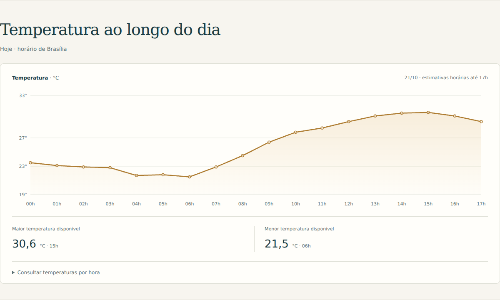
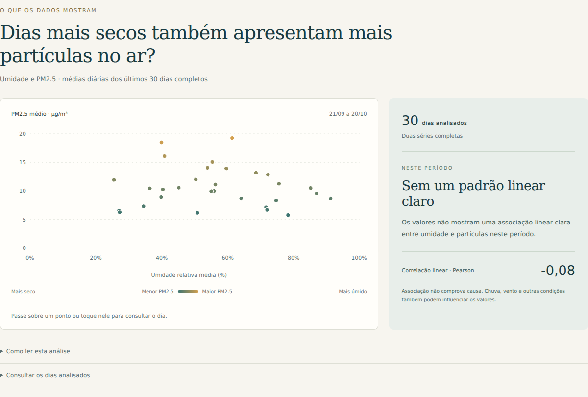

# Brasília em Ar

Clima, qualidade do ar e análise de dados para Brasília. Uma aplicação que conecta APIs públicas a uma interface própria, com visualizações interativas e interpretação dos resultados.


## Sobre o projeto

O Brasília em Ar reúne temperatura, sensação térmica, umidade, vento e concentração de partículas finas (PM2.5). A identidade visual combina tons de verde e dourado com uma ilustração da capital, mantendo o foco na leitura dos dados.

## Temperatura ao longo do dia

Evolução horária de hoje, com destaque para a maior e a menor temperatura entre os horários disponíveis. Os pontos podem ser consultados no gráfico ou em tabela.



## Análise exploratória

**Dias mais secos também apresentam mais partículas no ar?**

O gráfico cruza médias diárias de umidade e PM2.5 dos últimos 30 dias completos. O projeto trata valores ausentes, alinha as séries por data, calcula a correlação de Pearson e apresenta uma leitura que acompanha o resultado. Associação não comprova causa.



As capturas mostram a aplicação em funcionamento; os valores variam conforme o período consultado. Os dados são estimativas de modelos para a região, não medições de um sensor local.

## Tecnologias

React · TypeScript · TanStack Start · React Query · Recharts · Zod · Tailwind CSS.

A API própria reúne as fontes externas, valida as respostas e utiliza cache. A interface trata carregamento, falhas parciais e atualização dos dados.

## Executar localmente

Com **Node.js 24** instalado, abra a pasta do projeto no terminal:

```powershell
npm.cmd ci
npm.cmd run dev
```

Abra o endereço informado pelo terminal. Não é necessário cadastrar uma chave ou iniciar outro servidor. A consulta aos dados exige internet.

## Verificações

```powershell
npm.cmd test
npm.cmd run lint
npm.cmd run build
```

Os testes cobrem validação, fuso horário, lacunas, médias, pareamento das séries, correlação, falhas das fontes e cache. Consulte a [metodologia e documentação da API](docs/metodologia.md) para conhecer os critérios e limitações da análise.

## Fontes

[Open-Meteo](https://open-meteo.com/) · [CAMS/Copernicus](https://atmosphere.copernicus.eu/) · [CC BY 4.0](https://creativecommons.org/licenses/by/4.0/).

O projeto calcula estatísticas e adapta a apresentação dos dados. A API pública está sujeita aos [termos de uso não comercial da Open-Meteo](https://open-meteo.com/en/terms). A hospedagem precisa executar o servidor da aplicação; o GitHub Pages sozinho não executa a API.
